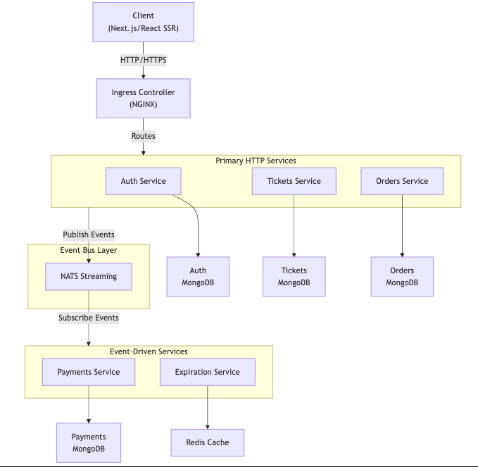

# Ticketing App - E-Commerce Microservices Platform

A scalable e-commerce web application demonstrating advanced microservices architecture, event-driven communication and containerized deployment patterns using modern cloud-native technologies.

## 📋 Overview

The Ticketing App is a sophisticated microservices-based e-commerce platform built to showcase comprehensive understanding of distributed systems, asynchronous event-driven architecture and containerized deployment. The application handles complex scenarios like ticket creation, order management, payment processing and order expiration - all while maintaining data consistency across multiple independent services.

**Current Status:** v1.0 - Local development on Kubernetes (Minikube). Ready for cloud deployment.

---

## 🏗️ Architecture

### System Architecture Overview



### Service Architecture

```
SERVICE TOPOLOGY:

┌─────────────────────┐
│   AUTH SERVICE      │  - User registration/login
│   :3000             │  - JWT token generation
├─────────────────────┤
│ Technologies:       │
│ • Express.js        │
│ • MongoDB           │
│ • JWT auth          │
└─────────────────────┘

┌─────────────────────┐
│  TICKETS SERVICE    │  - Create/update tickets
│   :3000             │  - Manage ticket listings
├─────────────────────┤
│ Technologies:       │
│ • Express.js        │
│ • MongoDB           │
│ • NATS Streaming    │
└─────────────────────┘

┌─────────────────────┐
│   ORDERS SERVICE    │  - Order creation/management
│   :3000             │  - Order status tracking
├─────────────────────┤
│ Technologies:       │
│ • Express.js        │
│ • MongoDB           │
│ • NATS Streaming    │
│ • Event Listeners   │
└─────────────────────┘

┌─────────────────────┐
│  PAYMENTS SERVICE   │  - Process payments (Stripe)
│   :3000             │  - Payment verification
├─────────────────────┤
│ Technologies:       │
│ • Express.js        │
│ • MongoDB           │
│ • Stripe API        │
│ • Event Listeners   │
└─────────────────────┘

┌─────────────────────┐
│ EXPIRATION SERVICE  │  - Handle order expiration
│   (No HTTP Port)    │  - Time-based event triggers
├─────────────────────┤
│ Technologies:       │
│ • Node.js           │
│ • Redis (cache)     │
│ • NATS Streaming    │
│ • Event Publisher   │
└─────────────────────┘

┌─────────────────────┐
│  NATS STREAMING     │  - Inter-service messaging
│                     │  - Event persistence
├─────────────────────┤
│ Features:           │
│ • Channels          │
│ • Subscriptions     │
│ • Message storage   │
│ • Fault tolerance   │
└─────────────────────┘
```

---

## 💡 Architecture Concepts & Theory

### 1. **Microservices Architecture**


**Implementation in This Project:**
- **Auth Service:** Handles all authentication concerns
- **Tickets Service:** Manages ticket catalog
- **Orders Service:** Orchestrates order creation and management
- **Payments Service:** Processes payment transactions
- **Expiration Service:** Handles time-based business logic

**Benefits Demonstrated:**
- **Scalability:** Each service can scale independently based on load
- **Technology Diversity:** Services can use different tech stacks (though we standardized on Node.js)
- **Team Autonomy:** Different teams can develop/deploy services independently
- **Resilience:** Failure in one service doesn't cascade to others (with proper error handling)

### 2. **Event-Driven Architecture with NATS Streaming**

**What It Is:**
An asynchronous communication pattern where services don't directly call each other. Instead, they publish events to a message broker and subscribe to events they care about.

**How I Implemented It:**
- Services publish domain events (e.g., `ticket:created`, `order:created`, `payment:success`)
- Event Channels group related events
- Services subscribe to channels and react to events
- Events are persisted in NATS Streaming for durability

**Real-World Flow Example:**
```
1. User Creates Order (Orders Service)
2. Orders Service publishes "order:created" event
3. Payments Service receives event, checks payment requirements
4. Expiration Service receives event, sets 15-min expiration timer
5. Tickets Service receives event, reserves ticket inventory
6. Each service updates its own database independently
```

**Advantages:**
- **Loose Coupling:** Services don't know about each other directly
- **Asynchronous Processing:** No request-response bottlenecks
- **Event Sourcing:** Complete audit trail of all events
- **Resilience:** If a service is down, events are replayed when it recovers
- **Scalability:** Easy to add new services that listen to existing events

### 3. **Database Per Service Pattern**

**Concept:**
Each microservice owns its own database. No shared databases across services.

**Implementation:**
```
auth-service    → auth-mongo
tickets-service → tickets-mongo
orders-service  → orders-mongo
payments-service → payments-mongo
expiration-service → redis cache
```

**Why This Matters:**
- **Data Independence:** Services can scale databases independently
- **Technology Flexibility:** Different services can use different DB types
- **Avoids Distributed Transactions:** Events are used instead of transactions
- **Schema Evolution:** Services can evolve schemas without affecting others

**Challenge Solved: Eventual Consistency**
Since there's no central database, we handle consistency through events:
- Orders Service creates order in its DB immediately
- Publishes event to other services
- Each service updates its own data based on events
- System is eventually consistent, not immediately consistent

### 4. **Server-Side Rendering (SSR) with Next.js**

**Why SSR?**
- **SEO Benefits:** Search engines can crawl fully rendered pages
- **Performance:** Initial page load is faster (no JS parse/execution delay)
- **Security:** API calls can be made server-side with secure credentials
- **Hydration:** Client receives pre-rendered HTML, then React takes over


### 5. **Container Orchestration with Kubernetes**

**Kubernetes Solves:**
- **Service Discovery:** Pods can find each other via service names
- **Load Balancing:** Automatic load distribution across pod replicas
- **Self-Healing:** Automatically restarts failed pods
- **Rolling Updates:** Zero-downtime deployments
- **Resource Management:** CPU/memory limits and requests

**Our K8s Setup:**
```
- Deployments: Manage pod replicas for each service
- Services: Expose services internally (e.g., auth-srv, tickets-srv)
- Ingress: Routes external HTTP traffic to services
- ConfigMaps & Secrets: Manage configs and sensitive data
- StatefulSets (via MongoDB): Manage databases with persistent state
```

### 6. **Concurrency & Data Consistency**

**Challenge:** Multiple orders for the same ticket simultaneously

**Solution Pattern:**
```javascript
// Optimistic Locking with Version Numbers
class Ticket {
  _id: ObjectId;
  title: string;
  price: number;
  userId: string;
  orderId?: string;
  version: number;  // ← Incremented on each update
}

// Update with version check:
db.Ticket.findByIdAndUpdate(
  { _id: ticketId, version: currentVersion },
  { $set: { orderId, version: currentVersion + 1 } },
  { new: true }
);
// If versions don't match, update fails → retry or error
```

**Why This Approach?**
- No locks (improves performance)
- Simple to implement
- Works well with event-driven architecture
- Used with Mongoose/MongoDB for atomic operations

---

## 🛠️ Tech Stack

| Layer | Technology | Purpose |
|-------|-----------|---------|
| **Frontend** | React + Next.js | Server-side rendering, UI components |
| **API Gateway** | Nginx Ingress | Route HTTP requests to services |
| **Services** | Node.js + Express | Business logic, REST APIs |
| **Languages** | TypeScript | Type safety, better DX |
| **Databases** | MongoDB | Primary data store (SQL-like scalability) |
| **Cache** | Redis | Session storage, expiration timers |
| **Message Bus** | NATS Streaming | Event-driven inter-service communication |
| **Container Runtime** | Docker | Containerize services |
| **Orchestration** | Kubernetes | Manage containers, scaling, networking |
| **Local K8s** | Minikube | Development environment |
| **Build Tool** | Skaffold | Watch → Build → Deploy automation |
| **Testing** | Jest + Supertest | Unit + integration tests |

---

## Key Learning Outcomes

1. **Architecture large, scalable apps** using microservices patterns
2. **Solved concurrency issues** in distributed systems (optimistic locking, event-based consistency)
3. **Built Server-Side Rendered React** apps with Next.js for performance/SEO
4. **Designed event-driven systems** using message-oriented middleware
5. **Implemented proper data patterns** (database-per-service, eventual consistency)
6. **Containerized applications** with Docker and orchestrated with Kubernetes
7. **Shared reusable code** between services using custom NPM packages
8. **Comprehensive testing** with Jest and Supertest
9. **Managed distributed tracing** and debugging across services
10. **Implemented authentication** and authorization patterns in microservices

---

## Setup & Running

### Prerequisites

Before running this application, ensure you have these tools installed:

- [Minikube](https://minikube.sigs.k8s.io/docs/start/) - Local Kubernetes cluster
- [Kubectl](https://kubernetes.io/docs/tasks/tools/install-kubectl/) - Kubernetes CLI
- [Docker](https://docs.docker.com/engine/install/) - Container runtime
- [Skaffold](https://skaffold.dev/docs/install/) - Development workflow automation

### Step 1: Start Minikube

```bash
minikube start
```

### Step 2: Enable Ingress Add-on

```bash
minikube addons enable ingress
```

### Step 3: Configure Hosts File

Add the Minikube IP to your `/etc/hosts`:

```bash
sudo vi /etc/hosts

# Add this line:
192.168.49.2    ticketing.dev
```

### Step 4: Build & Push Docker Images

Build Docker images for each service and push to your Docker Hub repository:

```bash
# For each service (auth, client, tickets, orders, payments, expiration):
docker build -t your_username/service_name .
docker push your_username/service_name:latest
```

**Important:** Update the image names in `skaffold.yaml` and `infra/k8s/*.yaml` files to match your Docker Hub username.

### Step 5: Create Kubernetes Secrets

Store sensitive configuration:

```bash
# JWT Secret for authentication
kubectl create secret generic jwt-secret --from-literal=JWT_KEY=your_secret_key

# Stripe Secret for payment processing
# Get your key from https://stripe.com/docs/keys
kubectl create secret generic stripe-secret --from-literal=STRIPE_KEY=sk_test_xxxxxxxxxxxx
```

### Step 6: Run Skaffold Development Mode

Skaffold watches your source files, automatically rebuilds, and redeploys:

```bash
skaffold dev
```

### Step 7: Verify Services Are Running

Check if all pods are in Running state:

```bash
kubectl get pods

# Expected output:
NAME                                        READY   STATUS    RESTARTS   AGE
auth-deployment-57d779fd9-48s9v             1/1     Running   0          24s
auth-mongo-deployment-579c6dbd8f-69jbv      1/1     Running   0          23s
client-deployment-f5cfc5b8d-k2lxp           1/1     Running   0          23s
expiration-deployment-6bb67856b4-jkkbl      1/1     Running   0          23s
expiration-redis-deployment-5b58b869fd-hmq5 1/1     Running   0          23s
nats-deployment-76479997ff-lpss8            1/1     Running   0          23s
orders-deployment-5c68dff5c9-dq6hl          1/1     Running   0          23s
orders-mongo-deployment-6896c8b9-42vpd      1/1     Running   0          23s
payments-deployment-68d4c7f4ff-nfsxb        1/1     Running   0          23s
payments-mongo-deployment-c89cb4fc7-4ggn7   1/1     Running   0          23s
tickets-deployment-7b746fff9-tvhzw          1/1     Running   0          23s
tickets-mongo-deployment-54f456bd95-hv9fb   1/1     Running   0          22s
```

### Step 8: Access the Application

Open your browser and visit:

```
https://ticketing.dev
```

If you see a certificate warning, type: `thisisunsafe` to proceed (this is for local development only).

---

## 📂 Project Structure

```
TicketingApp/
├── auth/                 # Authentication service
│   ├── src/
│   │   ├── app.ts
│   │   ├── index.ts
│   │   ├── models/
│   │   ├── routes/
│   │   └── services/
│   └── Dockerfile
├── tickets/              # Tickets service
├── orders/               # Orders service
├── payments/             # Payments service
├── expiration/           # Expiration service (background worker)
├── client/               # Next.js frontend
├── infra/
│   └── k8s/              # Kubernetes manifests
│       ├── auth-depl.yaml
│       ├── tickets-depl.yaml
│       ├── orders-depl.yaml
│       ├── payments-depl.yaml
│       ├── expiration-depl.yaml
│       ├── nats-depl.yaml
│       └── ingress-srv.yaml
├── skaffold.yaml         # Skaffold development config
└── README.md
```

---

## 🔄 Data Flow Examples

### Creating a Ticket

```
1. User logged in (Auth token obtained)
2. POST /api/tickets
3. Tickets Service receives request
4. Validates input & auth
5. Creates ticket in MongoDB
6. Publishes "ticket:created" event to NATS
7. Orders Service listens (if needed for order constraints)
8. Updates its view of available tickets
```

### Creating an Order

```
1. User selects ticket
2. POST /api/orders

3. Orders Service receives request
4. Checks ticket availability (Tickets service data)
5. Creates order in MongoDB
6. Publishes "order:created" event
7. Multiple services react:
   - Payments Service: Awaits payment
   - Expiration Service: Sets 15-min timeout
   - Tickets Service: Reserves the ticket
8. User makes payment
9. Payments Service publishes "charge:created" event
10. Orders Service transitions order to "awaiting:shipment"
    (In real app, would trigger fulfillment)
```

### Order Expiration

```
1. Order created (expires in 15 minutes)
2. Expiration Service receives "order:created" event
3. Stores timer in Redis
4. After 15 minutes, timer fires
5. Expiration Service publishes "expiration:complete" event
6. Orders Service receives event
7. If payment hasn't been received, cancels order
8. Publishes "order:cancelled" event
9. Tickets Service receives event
10. Releases the reserved ticket back to pool
```

---

## 📖 Learning Resources

- **Docker & Kubernetes Fundamentals:** [docker_k8s repository](https://github.com/neontvn/docker_k8s)
- **Docker Official Docs:** [docs.docker.com](https://docs.docker.com/)
- **Kubernetes Official Docs:** [kubernetes.io/docs](https://kubernetes.io/docs/home/)
- **Microservices Patterns:** [microservices.io](https://microservices.io/)
- **NATS Streaming:** [docs.nats.io](https://docs.nats.io/)
- **Next.js Documentation:** [nextjs.org/docs](https://nextjs.org/docs)

---

